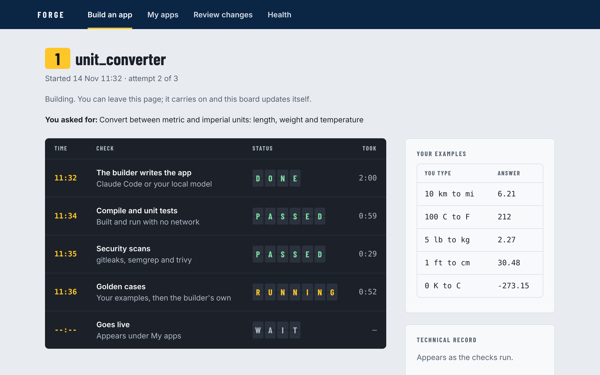
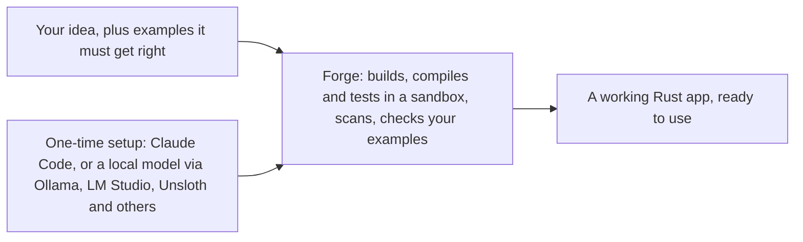

# Forge (Rust edition)

Type an app idea. Get a working app, written in Rust.





Inside the Forge box: the builder writes the app in a private copy; Forge compiles and tests it in a locked Docker sandbox with no network, scans it for security problems and checks it against your examples, then sends it back to the builder with the failures, a limited number of times. When everything passes, the app goes live. Forge then keeps watching the running app and proposes fixes, which wait for your approval.

This is the Rust rewrite of [Forge](https://github.com/AmshuKM/forge), which is written in Python and builds Python apps. Here both Forge and the apps it builds are Rust.

## What you need

| Tool | Needed for |
|---|---|
| Rust (cargo) and Git | Everything |
| Docker Desktop, running | The sandbox. Without it nothing can be built or tested, so nothing can pass the gates. |
| Claude Code, or a local model server such as Ollama | Building apps. Claude Code gives the best results; a local model is free. |

## Quick start

```bash
git clone https://github.com/AmshuKM/Forge-rust.git
```

```bash
cd Forge-rust
```

```bash
cargo run --release -- serve
```

Open http://127.0.0.1:8765. The first start compiles Forge (a few minutes) and looks for your models.

If another program already uses port 8765, Forge says so and stops. Pick another port by setting `FORGE_PORT`, for example `FORGE_PORT=8766`, before starting it.

## Build an app

On the **Build an app** page:

1. Describe the app in plain words, for example "A scientific calculator with sin, cos, log and powers".
2. Optionally add examples it must get exactly right, one per line: `2+3*4 -> 14`. These become checks the builder cannot change, so you set the standard rather than the AI.
3. Press **Build it** and watch the departure board: each check is a row whose status flips as it changes.

When every check passes, the app appears under **My apps**. If it can't pass after three tries, the page says why, and the work is kept.

## Choose your models and builder

On first start Forge looks for model servers on your computer (Ollama, LM Studio, llama.cpp, vLLM and Unsloth, on their usual ports) and picks a model for each of four roles: `main`, `think`, `fast` and `big`. To see what was found and choose yourself, including who builds apps:

```bash
cargo run --release -- setup
```

Your choice is saved in `config/local.toml`, which stays on your computer and is never committed. The builder is Claude Code when it is installed and signed in (it uses your Claude plan or API credit), otherwise your local model. If Claude Code fails mid-build, Forge switches to the local model.

## What an app is

```
apps/<name>/src/main.rs         the program: one function from Input to Step
apps/<name>/app.json            its description and form fields
apps/<name>/evals/golden.jsonl  the cases every future change is scored against
apps/<name>/Cargo.toml          written by Forge, never by the builder
prompts/<name>_*.md             optional, only for apps that call a model
```

Apps use Rust's standard library and one tiny helper crate, [sdk](sdk/src/lib.rs), which has no dependencies. [apps/slugify](apps/slugify/src/main.rs) is a plain app; [apps/docqa](apps/docqa/src/main.rs) uses a model.

An app never calls a model itself. It returns "I need a reply for this prompt", Forge makes the call, and runs the app again with the reply. So apps under test run with networking switched off entirely, and never see an API key.

## How a change reaches a running app

1. A change is made on its own Git branch, by the builder, by an agent you connected, or by Forge's own fixer after it finds a repeated crash, a failing golden case or a "not good" rating.
2. It must compile, pass unit tests, three security scanners and the golden cases, and must not score lower than the current version. App source may not use `unsafe`, files, the network, other programs or extra crates. Tries are limited; after that it stops and asks you.
3. A new app you asked for goes live as soon as it passes. Anything else waits for you to approve or reject it. Rejections are remembered.
4. An approved change to an existing app handles half the requests for a short trial. If they fail it is discarded; otherwise it is merged and tagged `release-<n>`.

Shared limits and which role handles which work live in [config/routing.toml](config/routing.toml).

## Build from your own agent instead

Forge also speaks MCP. Open this folder in Claude Code and accept the `forge` tools it offers ([.mcp.json](.mcp.json)), or point any MCP client at `cargo run --release --quiet -- mcp`. The agent gets seven tools: `guide`, `status`, `start_change`, `read_file`, `write_file`, `check_change`, `submit_change`. It works in a private copy, can touch only its own app's files, and has no tool to approve or release; its changes wait on **Review changes**.

## Testing without a model

- Unit tests and golden cases for apps that don't call a model need no model at all.
- To try an app that does use a model without having one, set `FORGE_MOCK=1` before starting Forge. Model calls return a fixed stand-in reply, so the plumbing runs but the answers are not meaningful.

## Commands

```bash
cargo run --release -- eval slugify
```

```bash
cargo run --release -- improve
```

```bash
cargo test
```

To also run the real sandbox test, which needs Docker and compiles, tests, scores and scans a sample app inside it:

```bash
cargo test -- --ignored
```

Every push is checked automatically on Linux, macOS and Windows, with the sandbox test on Linux: see the **Actions** tab.

## The dashboard's design

The dashboard is designed as a railway departure board. The rules live in [DESIGN.md](DESIGN.md) and [PRODUCT.md](PRODUCT.md). When you open this folder in Claude Code, it offers the [Impeccable](https://github.com/pbakaus/impeccable) design plugin, set up in [.claude/settings.json](.claude/settings.json); Forge works without it.

## Safety, plainly

- Unapproved code is compiled and run only inside a Docker container with a read-only copy of the project, a memory cap, no network and no API keys.
- Released apps run on your computer as normal programs. The source rules above and the scanners reduce the risk; they are not a proof. Read the diff of anything you approve.
- The dashboard listens on your own computer only.
- Only apps you asked for yourself go live without a click, and only after passing every check. The Health page has a switch that stops all self-improvement.
- This is a personal tool, not a hardened multi-user service. Do not expose the dashboard to a network.

MIT licence. See [LICENSE](LICENSE). The bundled font is Barlow Condensed, under the SIL Open Font License in [static/OFL.txt](static/OFL.txt).
